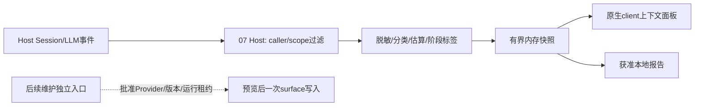

# 07 上下文观察与受控维护：软件设计

版本：CTX-DESIGN-2；日期：2026-11-07；状态：编码设计，功能未实现；独立评审状态见根[评审报告](../../docs/design-review-surfaces.md)。本文件是编码依据，优先于旧 PLAN 中未冻结的实现细节；没有把方案评审、源码阅读或05测试计为07运行通过。正式开工仍须按根 AGENTS 留 `implementation-route.md`，本轮不安装、不读凭据、不调用模型。

| 修订 | 来源/变更 | 影响ID/验证状态 |
|---|---|---|
| CTX-DESIGN-1 | 2026-11-06用户确认首版只读，维护后续增量；冻结阶段精度/Host接缝及独立维护合同 | CTX-01—09；设计文本自检，功能/Host/出口未验证 |
| CTX-DESIGN-2 / 2026-11-07（现行） | 独立评审SR-01：固定真实RPC、owner与项目许可分离、前端轮询及错误序列化；产品选择见[产品说明](product-form.md) | CTX-02/04/06/07；新增CTX-RPC-01合同；仅设计修订，功能/Host/出口未验证 |
| CTX-DESIGN-3 / 2026-11-07（实现补正） | 实现期发现rc.5无“已登记context发现”入口：新增owner-only只读端点`context.list`与registry `export_roots:[{root_ref,path}]`路径映射；RpcResult单层包装按实际字节落地。详见[变更单](design-change-ctx-rpc-02.md) | CTX-02/04/06；组件测试通过，隔离宿主RPC/Chromium待验证 |
| CTX-DESIGN-4 / 2026-11-07（实现补正） | 实测rc.5 `connection.rpc.handle`对profile插件不可用：传输改为`connection.fetch.register` exact `/api/context-mng/*`，BusinessResponse/授权/错误语义不变；exact route不传peer，owner门禁由Host共享handler先行执行。详见[变更单](design-change-ctx-rpc-03.md) | CTX-02/04/06；隔离rc.5 Host实测通过，Chromium页面旅程未执行 |

## 1. 产品目标、确认边界与首版旅程

最终产品是 Harness 内的“上下文”工作区：用户能回答“这个会话目前保留了哪些内容、最近一次模型请求在哪一层看到了什么、哪里花费上下文、哪些只是估算”，并在需要时预览一次手动维护。观察、维护和05长期记忆是三个独立概念。面板显示隐藏不代表模型遗忘；surface 维护不删除 append-only 会话日志。

已有依据：插件为主形态；先观察、后受控维护；估算/实报和请求阶段必须分开；不额外发送全文到分析服务；维护保留当前指令及工具配对；网络限批准模型API/明确可信目标；八项顺序05→07→08→06→03→04→02→01。产品项 CTX-PF-01 已由用户在本轮集中明确回复：首版只读观察，手动压缩后续增量。背景是实际请求观测可独立产生价值，持久维护需要额外事务/运行租约证明。此高层范围已确认，不再询问内部字段、按钮位置或锁算法。

首版旅程：

1. 用户在当前 Harness 会话打开“上下文”；页头固定显示当前会话、scope、观测时间和阶段。没有数据时解释“尚无本次请求观测”，不生成假数。
2. 默认展示来源组成列表和条形占比：系统、开发者/skill、用户、助手、工具定义、工具结果、05召回、未知。显示可见截断、不可估算图片和 provider 总量。
3. 用户展开某组，读取获准且经过秘密过滤的文本片段与来源；默认只给摘要和字符数。展开才按当前scope读取正文，切换会话立即清空旧数据。
4. 用户切换“历史surface / 预步骤 / LLM waterfall观测”视图。每个视图明确边界，未核实 wire 输入时不写“最终输入”。provider usage 到达后并列显示，不倒推出每组精确计费。
5. 用户可暂停刷新或导出当前经过过滤的报告到登记本地输出目录。关闭面板解除订阅，Host保留有限内存快照；停用插件不改变会话。

最终维护旅程（后置、设计已明确）：用户选择一个合法的旧工具结果→选择 omit 或通过既有批准Provider生成摘要→查看完整替换预览与保留说明→主动“应用”→校验同一会话版本/路由/运行空闲→append一条合法替换→flush证据→显示已持久化或结果不明。首个维护实现只允许单个 `tool/result` 的 content 替换；多轮整体压缩留下一版本，避免承诺未经验证的宽范围事件语义。

首版不做自动压缩、自动omit、Provider切换、prompt前后缀、长期记忆写入、日志删除、全局跨会话搜索、跨Agent比较或成本账单。多Agent只按独立session显示，不聚合未经授权的子会话。

## 2. 开工路线、来源和已知基线

实施顺序：固定构件/能力探针→纯投影与scope过滤→rc.5只读Host观察→原生client面板→完整隔离旅程/负向出口→独立评审；维护单独迭代。首个可验交付是两个合成会话的只读投影报告，证明A读不到B、估算/实报/未知不混淆且消息不被改动。

| 来源及固定身份 | 借鉴或采用机制 | 采用级别和证据限制 |
|---|---|---|
| 本机 Harness 0.2.1-rc.5；Node24.21.0/Electron44.7.0；`app.asar` SHA256 `e1b6f25fa937da98086c3e77af77aa14791105963c4d337a1c42179d232c6915` | Cordis生命周期、Session surface/事件、LLM waterfall、原生 keyed main panel | 运行时依赖已有安装；薄适配，不复制Host。Session/AppBoot包manifest MIT。05已有安装库探针；07自己的捕获/面板/持久维护未运行 |
| [dsh-context](https://github.com/bowenliang123/dsh-context/tree/73fd9a5c29e593c28311f4760da5d0b1bba0dc49) 0.80.3，调查固定树 `73fd9a5c29e593c28311f4760da5d0b1bba0dc49`，Apache-2.0 | 来源组成、演进与估算展示；只读路径剥离可选prompt注入 | 机制借鉴为默认。若局部源码可复用，实施时先锁具体文件/摘要/NOTICE，才能改为薄适配；当前没有合入。未下载发布包、不声称rc.5运行兼容 |
| [dsh-context-manager](https://github.com/SkanderBog/dsh-context-manager) | 预览/omit/压缩与观察分离的对照 | 仅调查，不是指定dsh-context的替代；没有固定构件/许可证据，不引入依赖 |
| 05 `docs/task3-host-interfaces.md`、`evidence/host-api`、`evidence/task3-host-api` | 已确认Provider准备/取消/unknown与来源锚边界 | 引用本地证据，不继承05业务授权为07任意路由授权。未来共享桥接须抽无凭据接口或显式版本依赖，不能跨目录引用未发布内部函数 |

来源调查内容见根 `docs/ecosystem-learning-research.md` §版本、Context；动态网页不是source-lock。本项目实施时 `source-lock.json` v1记录 `source_id, kind, repository?, commit?, package?, version, artifact_sha256, license, license_file, adopted_files[], host_version, runtime_version, verification_refs[]`。缺摘要/许可的候选不得作为可执行依赖；可行后备是本设计的自有分类器/面板，不需要Archify或外部服务。

## 3. 目录与职责

```text
plugin/index.ts                 # 唯一Host入口、服务注入、dispose
plugin/client.tsx               # 独立main面板入口；08有则提供导航descriptor
src/contracts.mjs               # 严格v1 schema及枚举、错误码
src/access.mjs                  # Host可信scope/session授权解析；UI不能自授grant
src/host-rc5.mjs                # rc.5事件/deriveMessages/llm waterfall绑定
src/capture.mjs                 # 只读采样与阶段身份，不保存request原对象
src/classify.mjs                # 来源规则；未知保持unknown
src/redact.mjs                  # 正文过滤/可信秘密标记+测试秘密识别
src/estimate.mjs                # 可替换计数器和误差标记
src/observations.mjs            # 有界内存缓存、订阅、revision与去重
src/export.mjs                  # 本地过滤报告、路径和原子保存
src/maintenance/range.mjs       # 后置：合法单tool结果范围与保护规则
src/maintenance/preview.mjs     # 后置：冻结预览、预算/路由与摘要
src/maintenance/apply.mjs       # 后置：一次提交、运行闸门与日志恢复
ui/ContextPanel.tsx             # 展示状态/分组/来源，不读磁盘
ui/context-store.ts             # session epoch、请求取消、旧响应丢弃
ui/context.css                 # 仅面板类名，复用Host主题与本地字体
schemas/*.schema.json           # observation/report/preview严格schema
tests/{projection,access,capture,cache,export,maintenance}.test.mjs
tools/{probe-host,observe-smoke,compact-smoke}.mjs
docs/{implementation-route,compatibility,mechanisms}.md # 后续实际证据
```

源码使用ESM；纯核心以 `.mjs` 配合JSDoc类型，Host/client按安装包实际工具链编译。正式package精确 `engines.dsh` 至 `0.2.1-rc.5`（验证新版再扩展），构建闭包离线固定；首版不引入tokenizer权重下载。Node24为Host验收基线，现有Node26只能作为补充。



## 4. 数据合同与确定接口

以下是本插件新定义的内部合同，不宣称是Host现有方法。schema必须拒绝额外字段；字符串ID长度1—128；时间UTC ISO8601；计数为非负安全整数；摘要是64位小写hex。optional不可用null冒充已知，明确可空字段除外。请求边界不接受任意文件路径或Provider配置。

```ts
type ScopeRef = { scope_id:string; generation:number; identity_digest:string };
type Boundary = {
  session_ref:string; scope:ScopeRef; last_event_seq:number;
  surface_generation:number; route_revision:string; observation_epoch:number;
};
type ContextObservationV1 = {
  schema_version:1; observation_id:string; revision:number; boundary:Boundary;
  captured_at:string;
  capture_stage:'session_surface'|'agent_pre_step'|'llm_waterfall';
  fidelity:'history_projection'|'request_observed'|'unavailable';
  request_ref:string|null; provider_ref:string|null; model_ref:string|null;
  observed_digest:string|null; // 经过脱敏投影的digest，不泄漏原文hash oracle
  wire_verified:false; // v1固定false；adapter内部投影仍可能变化
  groups:ContextGroupV1[];
  estimate:{method:'utf8_bytes_estimate_v1'|'locked_tokenizer';
    tokenizer_ref:string|null; tokens:number|null; complete:boolean;
    unpriced_modalities:string[]};
  reported_usage:{request_ref:string; input_tokens:number|null;
    output_tokens:number|null; cached_input_tokens:number|null;
    source:'provider_usage_chunk'; is_final:boolean}|null;
  limits:{context_window:number|null; max_output_tokens:number|null};
  truncated:boolean; omitted_bytes:number; unavailable_reason:string|null;
};
type ContextGroupV1 = {
  group_id:string;
  category:'system'|'developer'|'user'|'assistant'|'tools'|'tool_result'|
    'memory'|'unknown';
  source_ref:string|null; source_kind:string|null;
  message_refs:string[]; characters:number; bytes:number;
  estimated_tokens:number|null; certainty:'identified'|'heuristic'|'unknown';
  preview:string; truncated:boolean; redaction_count:number;
};
```

v1默认估算取“文本UTF-8字节数”作为保守显示计数，仅标签“UTF-8字节估算”；不把它与模型窗口进行精确利用率/费用换算，也不假设对所有tokenizer严格数学上界。未知模态计数为null、`complete=false`。若离线锁定特定tokenizer，再加`locked_tokenizer`，模型不匹配时退回字节估算。窗口未知就不画“剩余X tokens”。分组估算不要求与provider usage相加相等。cached input只并列展示，避免总数重复计入。

分类优先级：可信Host来源标签/工具类型→可信05注入来源标记→消息role与结构→unknown。不能从正文里写着“memory/system/secret”等词认定来源或权限。未知source不因看起来像skill就分类成skill。内容转义为text，禁止`dangerouslySetInnerHTML`。工具schema正文也计入观测但不把任意description当指令。

```ts
createContextService({host, access, policy, clock}): ContextService
getObservation({session_ref, expected_scope, stage}, caller):
  Promise<{status:'ok'; observation:ContextObservationV1}|
          {status:'denied'|'unavailable'|'stale'; reason_code:string}>
getGroupText({observation_id, group_id, offset, limit}, caller):
  Promise<{text:string; next_offset:number|null; revision:number}>
subscribe({session_ref, expected_scope, after_revision}, caller, listener):
  {dispose():void}
exportReport({observation_id, output_ref, expected_revision}, caller):
  Promise<{status:'saved'|'conflict'|'denied'; report_ref?:string}>
dispose():Promise<void>
```

`caller`只能由已鉴权Host RPC/CLI边界注入，不从JSON接受。正文页大小默认8192字符、最大32768；观察最多5000组、每组preview最多512字符、单session快照2MiB、每session最多8份、全插件总缓存32MiB，超过则截断或LRU淘汰并标明。常数是可调整工程上限，不是用户已确认性能指标。未经授权不计数正文（长度本身也可能敏感），先access再采样/估算。

本地报告v1为 `schema_version, capability:'07', report_id, exported_at, observation, redaction_policy_revision`；正文只含当前已过滤片段，不导出Host日志、原始headers/route/credentials。导出同目录临时文件→fsync→rename，并返回文件引用和摘要；相同report_id相同内容重复返回已保存，不覆盖不同内容。

## 5. Host接缝、精度标签与兼容后备

### 5.1 CTX-RPC-01：首版client/Host边界（确定设计，待实现）

实际rc.5 `dsh-client-connection/lib/index.js` SHA256为`0ebcca7583e082716f79b0b55bc1749d48269cc8db2989b043b321b57abd3684`：724—728提供`ctx.connection.rpc.handle(channel,handler)`，855—871把注册绑定当前fiber并经过`admit`，910调用`handler(endpoint,payload,request.signal,peer)`。client `lib/client.browser.js` SHA256 `dfc3544eb894c74b340a4c4c63a8c125fd2e983df9efed5885712574af994e62` 的1212提供`ctx.connection.rpc.call(channel,endpoint,payload,signal)`。这些是本轮只读源码事实，不是运行验收。

`plugin/index.ts`注入`connection`后仅注册`/local-context`；`plugin/client.tsx`仅调用此channel。处理器在闭包中从真实`peer.principal`取身份，首版仅接受`kind==='owner'`且peer未失效；拒绝其他principal，不读payload中的caller/principal/grant。`admit`已负责Host/Origin和认证，但浏览器共享owner Peer，不提供项目授权。`src/access.mjs`另外持可信本地`ContextAccessRegistryV1 {schema_version:1,revision,bindings:[{context_ref,scope:ScopeRef,session_ref,read:true,export_root_refs:string[],active:boolean}]}`：仅从用户已登记项目和真实Host会话映射加载，不能从模型、日志正文、cwd字符串或前端路由临时补登记。每请求查binding，核scope身份/代次与session仍对应；未绑定/撤权即denied。owner可以使用已登记范围，不因此能枚举或读取任意项目。

请求统一`{schema_version:1,operation_id,context_ref,expected_scope_generation,view_epoch,input}`；operation_id/view_epoch用于相关性，不能充当权限。未知字段拒绝，scope/观察ID/组ID必须再次join registry，防换一个ID越范围。请求decoded JSON上限64KiB，响应上限2MiB，正文继续按第4节有界分页。Host buffered RPC的全局body上限在T2须按锁定webServer配置验证；未证明请求资源限额时不对不可信远程开放该channel，不能把handler事后测长当传输层防分配证明。

| endpoint | input | 内部调用/返回data |
|---|---|---|
| `observation.get` | `{stage,after_revision?:number}` | getObservation；data=`{changed:boolean,observation?:ContextObservationV1,current_revision:number}`；相同revision返回changed=false；stage沿用三枚举 |
| `group.read` | `{observation_id,group_id,offset,limit}` | getGroupText；data=`{text,next_offset,revision}`；offset按UTF-16字符边界、非负安全整数，不截半代理对 |
| `report.export` | `{observation_id,output_ref,expected_revision}` | exportReport；output_ref须在binding.export_root_refs；data为原saved/conflict结果 |

业务响应闭合union：`{schema_version:1,operation_id,view_epoch,scope_generation,status:'ok',data:<对应endpoint结果>}`或`{schema_version:1,operation_id,view_epoch,scope_generation,status:'denied'|'stale'|'unavailable'|'invalid'|'failed',reason_code}`。reason_code限`OWNER_REQUIRED/CONTEXT_UNBOUND/SCOPE_REVOKED/STALE_SCOPE/STALE_OBSERVATION/INVALID_REQUEST/LIMIT_EXCEEDED/UNKNOWN_ENDPOINT/INTERNAL_FAILURE`等登记枚举；原异常、路径、Provider配置和stack不进入wire。处理器catch所有异常并转成固定`INTERNAL_FAILURE`，因为Host默认500会透传`String(error)`；不得把原Error交给该默认路径。写本地导出也复核operation digest，重复同内容返回既有回执，异内容拒绝。

**RpcResult传输合同（SR-01补正）**：上述带status/data的对象是业务响应BusinessResponse，不是实际RPC外壳。锁定connection源码的serverResponseSchema（Host 621—642、938）要求handler返回`{ok:true,value:BusinessResponse}`；包括denied/stale/failed等业务拒绝也放在value，插件catch全部异常后生成固定INTERNAL_FAILURE业务响应，不抛原Error。client的`rpc.call`返回RpcResult本身，不自动unwrap：先检查`result.ok`，仅为true时validate(result.value)后再检查view_epoch/scope_generation和业务status。Host连接层可能返回`{ok:false,error:{code,message,details}}`；客户端映射为固定TRANSPORT_FAILURE，不展示原message/details且不自动重发写操作。插件不自行双包type/rpcId，它们由connection管理。T2/T4/T5按本能力执行一条实际handle→call正常、业务拒绝、transport失败、旧epoch及异常金丝雀用例；仅模拟返回BusinessResponse不能认证RPC可用。

**CTX-DESIGN-3实现补正**：首版增加owner-only只读端点`context.list`（请求无context_ref，仅返回已登记active绑定摘要，不含路径/正文），用于Client把当前主会话映射到已登记`context_ref`；registry增加顶层`export_roots:[{root_ref,path}]`，wire只暴露`root_ref`。详见[设计变更单](design-change-ctx-rpc-02.md)。

**CTX-DESIGN-4实现补正**：rc.5的`connection.rpc.handle`对profile插件不可用（实测必抛`cannot get property "webServer" without inject`），浏览器传输改为`connection.fetch.register`的exact `/api/context-mng/*`路由；BusinessResponse、严格请求外壳、owner/registry授权和错误映射保持不变，exact route不传peer而由Host共享handler先行完成owner门禁。详见[CTX-RPC-03变更单](design-change-ctx-rpc-03.md)。


第4节`subscribe(...,listener)`是**Host进程内接口**，不跨JSON传函数。前端打开面板后每500ms有界轮询`observation.get(after_revision)`，同view最多1个在途，后台隐藏暂停；需要正文再调用group.read。切会话、scope撤权、关闭和卸载abort轮询、增加view_epoch并清正文；响应epoch/generation不匹配直接丢弃。Host共用原事件监听和有界缓存，不按每次poll重复注册。fiber dispose卸载channel/监听，既有模型stream继续透明yield；不取消主模型请求。

T2/T3追加负例：真实安装库同一channel穿过认证Peer＋registry；owner但未绑定scope、伪造caller/grant/ID、撤权、旧代次、未知endpoint、超限、故意含金丝雀的异常均拒绝或固定脱敏；暂停/切会话/卸载无迟到展示。完整UI和OS出口仍待实际执行。

### 5.2 观察接缝与后备

本机证据：05 `evidence/host-api/dsh-session/lib/index.js` 的 `deriveMessages()` 返回当前surface的冻结消息快照，append-only日志仍在；`ctx.on('session/event',(session,event)=>...)`可观测事件；LLM源码 `stream(options)` 经 `ctx.waterfall(this,'llm/stream',options,()=>adapterStream(...))`；AgentLoop在边界创建含 `sessionId,messages,tools,signal` 的冻结options。这些是源码已核，完整07运行未验证。

实现绑定方式：

1. `host-rc5.mjs`按实际注入的获准Session读取 `deriveMessages()`，记录 `surface.contentGeneration` 和最后seq；不枚举全部session store。读取前后比较boundary，变化就丢弃重采一次，再变返回stale。该模式始终 `history_projection`。
2. 可选 `agent/pre-step`只标 `agent_pre_step`；原样透传payload并尊重既有waterfall决定，不做prompt任何修改。
3. 在`llm/stream`中通过真实`options.sessionId`定位已授权session，仅复制获准投影，调用`next`恰好一次。返回一层透明AsyncIterable来观察`usage`/明确`finish`，原chunk对象逐项yield，不修改、不缓冲全部stream。采样失败只丢本插件观察并记录非秘密原因，不吞主请求异常。多个middleware顺序可能改变下游options，故标签是`request_observed`且 `wire_verified=false`；绝不称provider最终wire全文。
4. `request_ref`使用本地单调序号+session+代次映射；同session并发不能仅按“最后一次”归usage，必须捕获同一个stream闭包。信号取消后迟到usage仍属于原请求、标非final，不能贴到新请求。
5. UI用已读取的rc.5 `ctx.slots.inject('main',()=>ctx.slots.register({name:'main',key:'local-context'},Component))`与`ctx.layout.selectPanel('local-context')`。Host package清单需声明 `dsh.client.inject` 的实际包，不把Host入口模块当client。注册关闭时清理scope订阅。08导航只调用本插件入口，不复制ContextStore。

UI证据来自本机同一asar：`@deepseek-ai/dsh-client-ui-layout/lib/client.js` SHA256 `eb011a7b5699fac7f3ad0aa15408f46a6cf47f79b8cc15db1f81739e81e70587`，main为keyed/root，`selectPanel(null)`返回聊天；slots renderer `lib/client.js` SHA `dbdb3f26bfbc1d143bc8a0eed5982a2507c4f0cf8027e7c170f3bed3604be356`实现effect管理注册。只是源码接缝证据，类型/打包/运行旅程仍由T2核验。

后备是确定的：若llm waterfall形状不符，不安装未知版本observer，保留surface投影且请求观测显示unavailable；若原生main slot缺失，07核心CLI `tools/context-report.mjs --fixture/--session-ref`可导出本地只读报告，正式Harness UI交付判blocked，不把CLI算界面通过。无rc.5兼容的upstream也使用自有最小实现，不为07升级Harness。读取真实session的CLI必须经运行中Host服务鉴权，禁止直接扫描持久目录作为“fallback”。

## 6. 生命周期、并发、取消和恢复

observer状态：`disabled → starting → observing ↔ paused → stopping → disabled`；能力缺失转`degraded`，安全边界缺失转`blocked`。UI状态独立为`loading/ready/empty/stale/denied/unavailable/error`。一次观测失败不令主模型请求失败；access判定失败不得降级为读取。

每session一个revision序列，去重键为`session_ref + stage + request_ref/boundary + filtered_digest`。Host同一事件重复送达不复制snapshot。订阅复用一份Host监听而非每个view各挂；view引用计数归零时停正文刷新。事件合并窗口100ms、刷新最多10Hz；每session最多一个采样执行中，后来的事件只保留最高boundary。缓存写入前复核scope generation。session移除立即清缓存；03 rewind/restored事件先失效，再按获准session重新读当前surface，事件缺失/重启不可将缓存当最新。

UI请求绑定`view_epoch`；切会话或关闭面板 `AbortController.abort()`，清空旧正文并增加epoch；旧Promise即使完成也不更新当前view。暂停仅停止本面板请求，不停止聊天、不撤回已有模型调用。Host卸载透传stream的包装器停止记录但继续yield，使原请求语义不变；不能为清理observer取消主模型。

观察不持久化正文，重启为空，用户导出例外。非秘密诊断最多保留错误码/时间/计数，不写request内容。重启之后显示“尚未观测”，不恢复上次“活跃”标签。schema未知版本拒绝读取，报告只读不执行迁移代码。

## 7. 后置维护：足够确定的实现合同

不要求用户确认内部维护机制；本节是后续增量开发约束。用户已确认首版只读，维护enable首版固定false；后续维护增量必须通过Host写路径验收再开放。

```ts
type MaintenancePreviewV1 = {
 schema_version:1; preview_id:string; operation_id:string;
 boundary:Boundary; created_at:string; expires_at:string;
 target:{event_seq:number; message_ref:string; content_digest:string};
 method:'omit_tool_content'|'summarize_tool_content';
 replacement:{role:'tool'; tool_call_ref:string; text:string};
 source_event_seqs:number[]; protected_refs:string[];
 route:{route_ref:string; revision:string; provider:string; model:string}|null;
 budget:{max_input_tokens:number; max_output_tokens:number; max_calls:1}|null;
 state:'ready'|'stale'|'consumed'|'cancelled';
};
createPreview({boundary,event_seq,method,route_ref?},caller,signal)
  -> ready|denied|invalid_range|route_unavailable|outcome_unknown
applyPreview({preview_id,expected_boundary,operation_id},caller)
  -> persisted|stale|denied|applied_unflushed|outcome_unknown
```

预览默认TTL十分钟；生成时冻结route和预算，摘要仅通过批准Host LLM service，禁止读env key/新增Provider/失败换模型。没有可信完整route revision时摘要拒绝，可行替代是纯本地omit。摘要按05已核终结片段/stream完成/取消规则，不把`BlockAssembler.finish`默认stop当成功。取消调用后远端状态不明保持`outcome_unknown`，用户可弃预览，不自动重发。

范围规则：只能已完成旧 `tool/result` 的单节点content；必须能在当前surface找到对应call且完整配对，失败/成功metadata、toolCallId、消息身份均不变。保护当前轮及最近用户指令、system/developer、grant/作用域信息；工具结果内具有关键当前授权证明的目标禁止omit。生成摘要标“模型生成，原文仍在会话记录”，明确省略；模型产物不得新增权限或改写protected_refs。整段历史压缩的语义、保留当前指令检查另立CTX-09，v1不会悄然扩大范围。

原子边界：插件按session持有maintenance mutex；实际写前需Host提供与Agent调度共享的运行空闲租约。仅`if idle`检查后await不是租约。rc.5暂无本轮运行证明的共享租约API；T5必须锁实际导出并进行并发实验，若不可获得，则维护保持disabled，提供可复制摘要/重新开聊作为可行替代，绝不私改Session字段或只用本插件锁。

在租约内重新核验boundary、current target、grant、route、tool配对；同步append，不在比较与append之间await。单工具结果使用已核的 `session.append('tool/result', sameDataExceptContent, {surfaceOp:{op:'replace',startSeq:s,endSeq:s},sourceEventSeqs:[s]})`，具体消息block schema由T5真实库fixture固定；不伪造assistant stream或遍历修改log。原结果事件永不删。维护journal写prepared并fsync→append→记accepted(seq/digest)→`ctx.sessions.flush(session)`→persisted；flush false/异常不算持久化。Host实际write handle/flush语义须探针确认，不把05内存flush(false)当通过。

提交idempotency基于operation_id。已有persisted返回同结果；accepted但flush不明时通过同session重放日志找到准确replacement seq和digest，找到则仅重试flush，不再append；未找到而持久加载完整性无法证明时保留unknown。append生效后取消不能回滚成未执行。journal损坏/磁盘满先停止维护，观察继续；恢复旧profile不能清掉operation ledger导致再次append。后续03事件使预览stale，收到outcome_unknown事件也阻断写入直到重核，不把缺after_snapshot猜成成功。

## 8. 本地性、权限和出口

07观察路径没有网络能力、没有子进程、没有自动更新/下载。只有后置摘要有一次已批准模型路由。UI/RPC的scope/session在Host按caller检查，secret mark和不允许来源先丢弃，再做显示过滤；未获准文件不读取正文来“检查是不是秘密”。本插件不读取凭据配置，只接收不含secret的批准route引用。

前端复用Host会话鉴权与连接，不自行开公网监听；跨origin/伪造session参数、无权限导出均拒绝。Host route若未验证，先不挂UI数据端点，fixture CLI仍可验证核心。CSP使用Host服务本地资源，`connect-src`仅Host授权通道，禁远程图标/字体/图片和HTML执行。脱敏不是唯一隔离：网络出口要对Host/Chromium及子进程整体验证；Node monkeypatch只能算覆盖API检测。

工程参数（缓存/TTL/阈值/分类规则/文案）可后续由skill建议调整；scope验证、来源真实性、秘密出口、一次提交、版本校验是plugin/Host硬边界，改skill不得绕过。

## 9. 实施任务与验收

以下均未执行；命令在07目录运行，`runtime/node.exe`、所有脚本与隔离宿主由各任务准备后才存在。每任务：先写指定失败行为→运行确认失败→最小实现→同命令通过并保存退出码/TAP/构件摘要，不能只测试内部函数名。实现不自动commit（本工作区未初始化Git）。

| 任务 | 文件/确定交付 | 验收命令与关键正负例 |
|---|---|---|
| T1 / CTX-01,02 | source-lock、contracts/access/classify/redact/estimate；两个合成scope的观察报告 | `./runtime/node.exe --test tests/projection.test.mjs tests/access.test.mjs`：来源保留/unknown，usage不分摊；A读B拒绝，假秘密不输出，超限有truncated，未知图片不算0 |
| T2 / CTX-03 | host-rc5/capture；安装字节及真实API探针 | `./runtime/node.exe tools/probe-host.mjs --isolated`：真实Session derive与llm fake adapter经过同一middleware，消息/stream字节和次数不变；错误next/重复usage/缺sessionId不误归；主请求异常透传。使用实际安装库，不导入复制证据 |
| T3 / CTX-04,05 | observations、client/ContextPanel、export、独立main入口 | `./runtime/node.exe --test tests/cache.test.mjs tests/export.test.mjs`；`./runtime/node.exe tools/observe-smoke.mjs --isolated --fixture`：A/B快速切换旧响应不闪回，关闭/重开/卸载监听归零，暂停不影响聊天，导出越根/旧revision/符号链接拒绝，键盘可完成旅程 |
| T4 / CTX-06 | 实际Loader/Host/Chromium出口验收与08descriptor | `./runtime/node.exe tools/observe-smoke.mjs --isolated --fixture --network-evidence`：离线冷启/错误/导出/卸载零未登记网络尝试；真正主请求比较仅synthetic+fake adapter。完整已授权模型测试按根安装计划后置，不用本轮调用 |
| T5 / CTX-07,08（后置） | maintenance、journal、实际共享运行租约/flush探针 | `./runtime/node.exe --test tests/maintenance.test.mjs`；`./runtime/node.exe tools/compact-smoke.mjs --isolated --fixture`：合法单工具结果仅改content；并发新turn/provider/rewind/撤权使旧preview拒绝；缺结果/当前指令拒绝；崩溃于append/flush中间仅一次替换，unknown不盲重发 |
| T6 | docs/mechanisms.md、复审和完整产品验收 | 逐条对照下面映射；列已实际运行证据和缺口，observer可先独立交付，维护未通过保持后置 |

运行记录v1：`schema_version, command, started_at, runtime, host_archive_digest, source_lock_digest, fixture_digest, exit_code, pass, fail, skip, evidence_refs, limitations[]`。零skip不是唯一合格条件，关键负例未执行必须显示未验证。每个Host适配探针报告是“安装库/完整Host/UI/出口”哪一层，不能合并计数冒充系统认证。

## 10. 需求到模块/接口/测试的变更地图

| ID | 行为要求 | 模块及接口 | 必要回归 |
|---|---|---|---|
| CTX-01 | 来源/估算/实报阶段独立 | contracts,classify,estimate / ContextObservationV1 | projection；真实请求捕获compare |
| CTX-02 | 先scope后正文，秘密不展示/导出 | access,redact,export / caller注入 | access/export负例与出口 |
| CTX-03 | 观察不改prompt/历史/stream | host-rc5,capture / middleware | prefix/suffix遗留配置、真实库透明性 |
| CTX-04 | 切换/订阅/大输出可控 | observations,context-store / subscribe | cache、卸载/迟到响应smoke |
| CTX-05 | 本地可审报告 | export / exportReport | 路径、重复/冲突、脱敏 |
| CTX-06 | Host精确兼容与无旁路 | plugin/source-lock / probe | Loader、CSP/网络、disposer |
| CTX-07 | 后置预览冻结与工具保护 | maintenance/range,preview | 新turn、缺配对、provider变更、预算 |
| CTX-08 | 后置一次持久化/unknown恢复 | maintenance/apply / applyPreview | 租约竞争、磁盘满、崩溃恢复 |
| CTX-09 | 多轮整体压缩 | 后置独立schema版本 | 未设计为首版；需新产品范围审查与Host语义证据 |

局部变更方法：按根 `docs/design-change-policy.md`，先标受影响ID→改本文件该接口/策略→schema破坏变更升major并拒绝旧请求；增optional字段需保留v1严格解析的协商路径，不能直接塞给旧client→修改所属模块→运行表中必要测试及受影响Host旅程→更新source-lock/兼容矩阵/机制ID。样式/分组顺序只改UI与projection回归；新增Provider/写范围影响CTX-02/06/07/08，必须重新出口/并发验收，不能藏在skill文字里。产品目标或首版范围变化才回到用户高层确认，常规内部实现不逐条询问。

接口稳定ID：CTX-API-READ=`getObservation/getGroupText`，CTX-API-SUB=`subscribe/dispose`，CTX-API-EXPORT=`exportReport`，CTX-API-MAINT=`createPreview/applyPreview`（后置）。验收ID为CTX-AT-T1—T6，对应任务表；后续删除/替代保留ID去向。

## 11. 设计退出与尚待验证

当前可据此编码，未完成事项明确：rc.5真实client模块打包/slots行为、scope与RPC可信映射、LLM waterfall顺序对观测的影响、实际adapter wire投影、全进程出口、共享运行租约和持久flush。每项都有T2—T5验证或确定降级：surface报告/自有UI/禁用维护。没有这些证据时仍可交付标明精度的只读核心，不能声称“最终wire完整可视化”或“已可安全修改历史”。

**接下来该怎么做：** 正式进入07实施时用约30分钟完成T1的双会话fixture失败用例和schema检查；完成标准是能明确复现A读B被拒、未知token保持未知、观察不改原消息，本轮尚待实施与验证。
